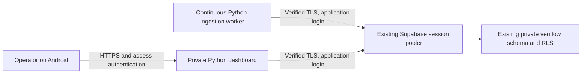

# Deployment decision: keep Supabase private, move the runtime

## Recommendation

Use an **always-on Python web service plus a background worker on Render**, both from this existing repository/feature branch, and connect them to the **existing Supabase IPv4 session pooler**. This is a supported managed-hosting candidate, not a deployed or connection-verified service. It avoids rebuilding the SQL/transaction layer, provides browser-based secret configuration suitable for Android, and separates dashboard availability from worker restarts. Choose always-on paid instances rather than a sleeping/free dashboard; hosting cost needs its own approval and is separate from the $1 collector test allowance. No service has been created or paid plan selected.

If an existing persistent Linux VM is already available, use that instead: it is the smallest change and can run the supplied `deploy/veriflow-admin.service` and `deploy/veriflow-worker.service` together. No suitable persistent host or Render account has been identified/authorized in this session; no alternative host has yet passed live PostgreSQL verification. Codex Cloud remains a development workspace, not the continuous production runtime.

## What the network evidence establishes

No PostgreSQL probes were repeated for this decision. Retained evidence is summarized in `docs/database-connectivity.md`.

- Direct endpoint: IPv6-only DNS plus OS `ENETUNREACH` identifies a usable-IPv6-routing failure in this workspace's path. This is independent of database grants/passwords.
- Exact user-supplied session endpoint: all three IPv4 addresses refused TCP 5432, also outside the sandbox; the workspace HTTP proxy closed on PostgreSQL SSLRequest. This identifies failure before TLS/authentication but cannot locate the rejecting layer. Egress restrictions, Supabase Network Restrictions and pooler availability remain distinguishable possibilities.
- Environment policy reports unrestricted, but that is not packet-level proof. The managed environment diagnostics index has no retained capture or legacy snapshot, so it supplies no additional root-cause attribution. No raw diagnostics were retrieved.
- Supabase's earlier healthy status and successful management queries establish management/database service availability, not public pooler reachability. No evidence justifies resetting credentials, disabling TLS/RLS or claiming a global Supabase pooler outage.

One connection acceptance check on the chosen deployment host is the next discriminating step. Success there localizes the remaining problem to the Codex path. Refusal there requires inspecting the exact project's Network Restrictions and pooler status, or Supabase support, before another host move. A permitted egress address can be explicitly approved if restrictions require it; no broad allowlist or restriction removal is proposed.

## Alternatives assessed

| Method | Preserve private schema and RLS? | Work required / decision |
|---|---|---|
| Persistent Python host → existing session pooler | Yes; existing non-owner `veriflow_app` login and runtime policies | **Recommended.** Existing SQL, transactions, advisory locks, grants and worker stay intact. Verify connectivity from that host. |
| Supabase HTTPS Data API directly | Private schema is intentionally unavailable through it today | **Do not use as a shortcut.** Exposing `veriflow`, granting broad roles or using a service key to bypass RLS conflicts with the design. A separately scoped API facade is possible but requires a reviewed authorization design and new API operations. |
| HTTPS → authenticated Edge Function → private PostgreSQL | Yes, if the function uses the dedicated app login and explicitly authorizes callers | Supported fallback for bounded operations, not the simplest continuous-worker deployment. Requires an API layer and transaction/business-rule refactor. No function was deployed. |
| GitHub Actions | Can run bounded jobs when networking/billing permit | Existing account billing lock blocks runners; not a continuously available dashboard. Keep manual read-only secret verification separate. |

## Render deployment shape

Official [background-worker documentation](https://render.com/docs/background-workers) explicitly supports continuously running processes; [Python web-service documentation](https://render.com/docs/deploy-flask) documents managed Python deployment. [Outbound IP documentation](https://render.com/docs/outbound-ip-addresses) documents regional egress addresses for external database allowlists. This establishes a supported platform shape, not successful connectivity to this specific project.

- Web service: install pinned `requirements.txt`; run `python -m veriflow admin --host 0.0.0.0`; the managed PORT environment setting is supported. Loopback `127.0.0.1:8080` remains the default. See continuous-runtime.md for the pending scheduling migration before deploying this revision.
- Worker: same code revision and dependencies; start `python -m veriflow worker`. The current worker schedules approved queued imports; it does not automatically submit new Apify jobs. An optional known-run monitor is now implemented; paid submission automation remains a separate explicitly approved change. No source is activated by deployment.
- Operator access: managed HTTPS and existing operator-only admin authentication on every data route; no anonymous data or browser database credentials. Retain an existing access gateway/private network if one is used, or add one as an additional restriction when available; never expose the dashboard over unencrypted public HTTP. No public affiliate website is involved.
- Secrets: enter the existing application database connection and admin credentials directly into the host's server-side secret/environment settings. APIFY_TOKEN can later be added through the same phone-accessible controls. No secrets in Git, build arguments, workflow inputs, browser code, logs or support messages. Never copy a token through this chat. The GitHub secret is not automatically transferred to another runtime.
- Database settings: host `aws-1-us-west-2.pooler.supabase.com`, port `5432`, database `postgres`, username `veriflow_app.qrejfpeclncrevmepgzx`, existing password, `sslmode=verify-full`, applicable official/system CA trust, and `SUPABASE_PROJECT_REF=qrejfpeclncrevmepgzx`. Keep the hostname for certificate verification.
- Set `APIFY_PAID_RUNS_ENABLED=false`, run/day spending allowances zero until explicitly configured, records at most 20, and retain the versioned paid-authorization false. No automatic Actor start or collector schedule.
- Do not run migrations/seed at service startup: the existing 13 tables and 42 disabled sources are already installed. No additional database or owner application connection is needed.

## Secure Edge Function fallback

Supabase [officially supports PostgreSQL clients inside Edge Functions](https://supabase.com/docs/guides/functions/connect-to-postgres). A narrow function could read private tables without adding the schema to Data API exposed schemas. Server-side direct queries must use the existing restricted application login, not the default owner URL or `supabaseAdmin`/service-role bypass. Explicit verified TLS remains required. The function's deployed network route must itself be verified; deployment location alone is not proof of connectivity.

An acceptable bridge would verify the caller's signed, unexpired JWT and authorize a specific operator/service identity through server-controlled policy. Merely possessing an authenticated Supabase account is not sufficient. Current dashboard Basic authentication is not already a Supabase Auth session; the caller/auth flow would need implementation. Forwarding a JWT does not automatically scope raw SQL using `veriflow_app`: existing runtime RLS applies, and the API must additionally enforce caller permissions and all source grants.

Expose only fixed, parameterized, paginated operations with request-size limits, rate limits, sanitized errors and no secret/account-payload logging. Never accept arbitrary SQL, role names, table names, caller-selected database credentials, or a generic proxy operation. Preserve transaction boundaries, budget locks, authorization/revocation checks, deduplication and provenance within server operations. Keep secret credentials in native function secrets; do not return them to Codex. A read-only source-count operation could validate the bridge first; review writes need further implementation/testing.

[Hosted Edge Function limits](https://supabase.com/docs/guides/functions/limits) include 150s free / 400s paid wall-clock lifetime, 2s CPU per request and 256 MB memory. They fit bounded requests, not the existing indefinite Python worker loop. They also do not directly host the current Python dashboard. A cron/task design plus a dashboard host and API client rewrite would be necessary. That makes this the fallback if native database transport is unavailable on the selected application host, not the first choice.

## Acceptance before declaring readiness

1. Select an existing host or approve a concrete hosting plan; configure existing secrets in its native controls, without regeneration. No credentials are requested in chat.
2. On that host only, run `python -m veriflow check-database` and require healthy=true: correct app role, verified TLS, 13 tables, RLS, denied public grants and 42 sources.
3. Check authenticated dashboard `/sources` returns 200 and displays 42 sources; anonymous access must still return 401 or be denied by the access gateway. Validate all database-backed views.
4. Confirm the idle worker can use the same database with zero enabled sources and no paid execution. Exercise an approved synthetic import only in a disposable/staging database, never populate production with fake reviews.
5. Confirm private access, secret handling, restarts, redacted error reporting and the disabled paid policy before enabling continuous service.

Until those checks pass, report **deployment architecture selected; application connectivity unverified**, not READY FOR APIFY CONFIGURATION. Existing Supabase project, schema, grants, credentials and Draft PR #1 remain unchanged/unmerged.
